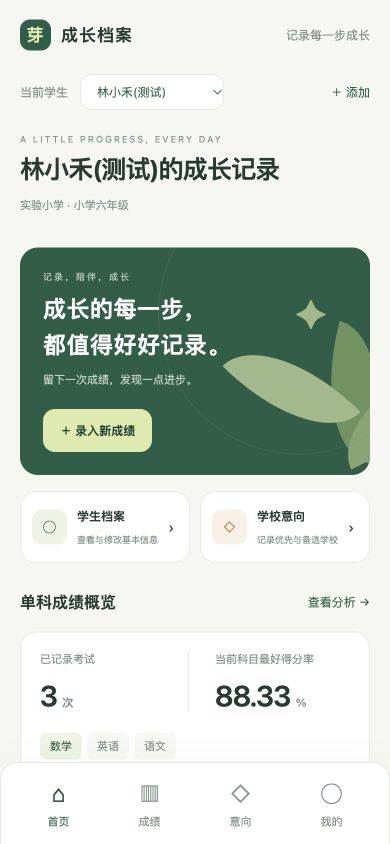
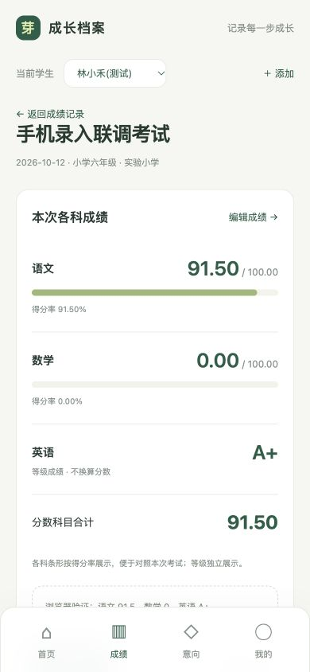
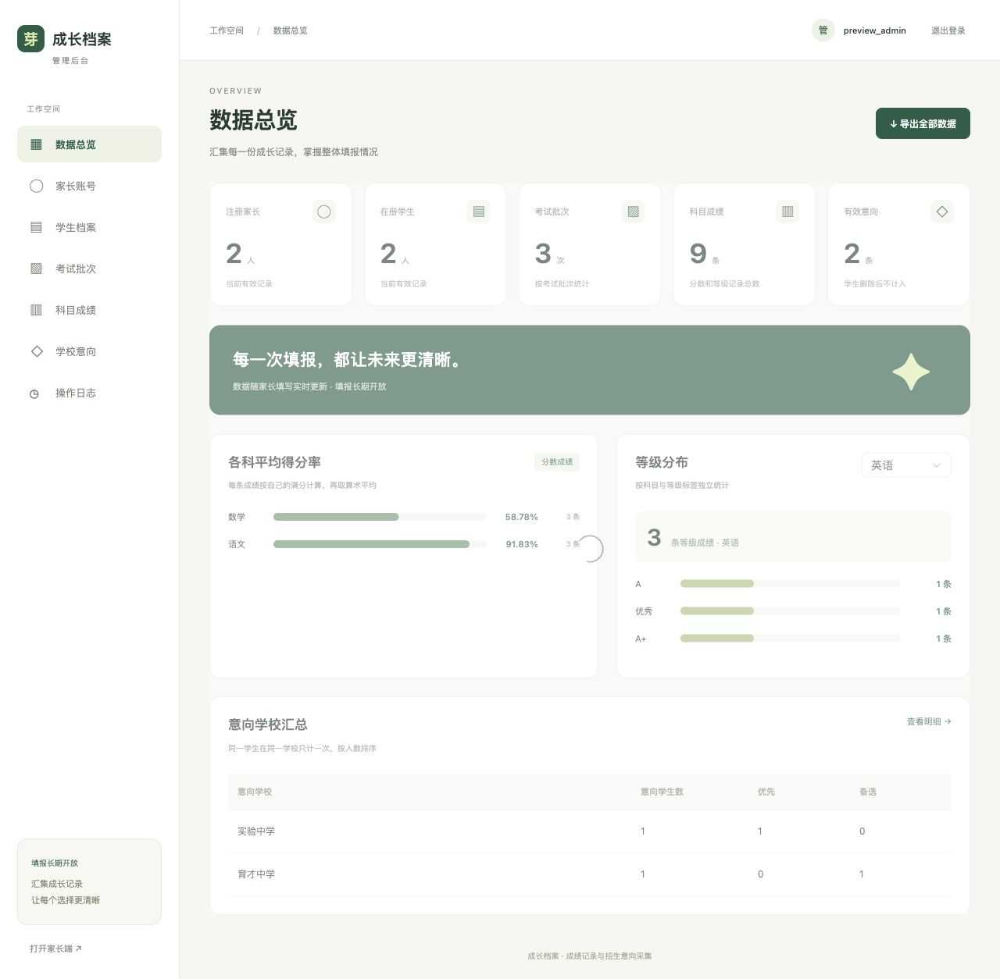
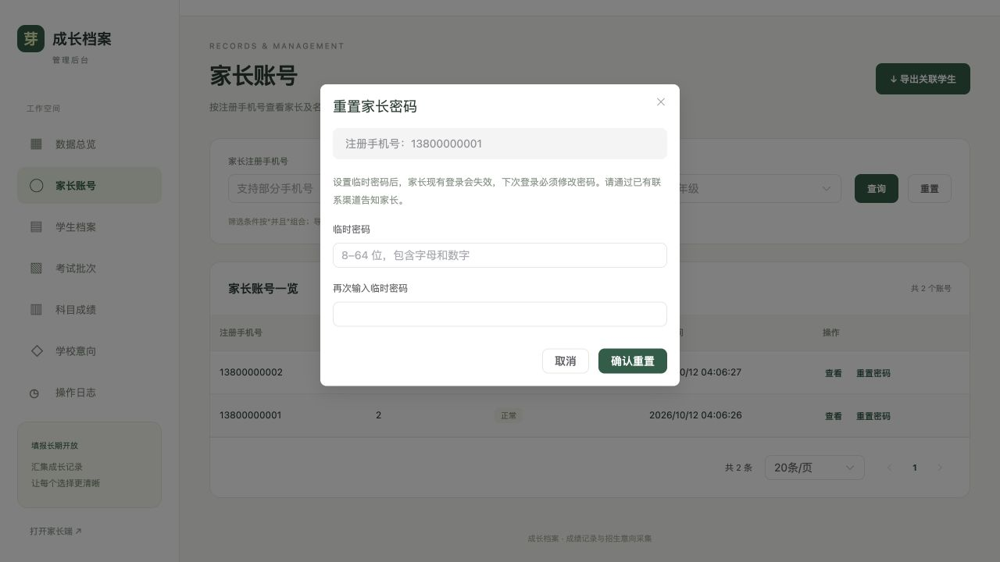
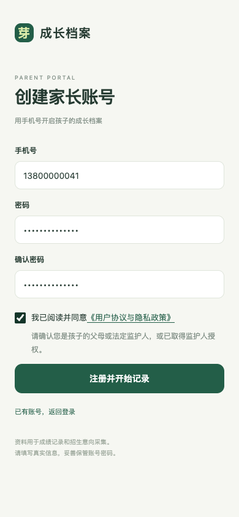
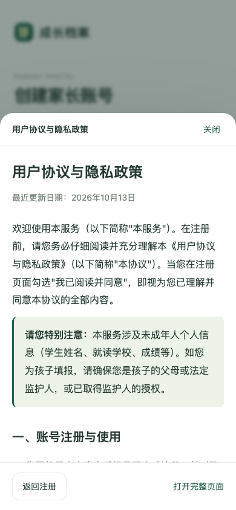

# 首版验收记录

日期：2026年10月12日。源码及配置以开发设计文档 V1.5 为准。

## 已运行的检查

| 检查 | 结果 |
| --- | --- |
| PHP 8.4.5 / Laravel 13 迁移 | 提供的 shengxue360 库八项迁移全部完成 |
| 内存 SQLite 自动化 | 21 tests / 191 assertions，全通过 |
| 独立 MySQL 9.2 自动化 | 同一套 21 tests / 191 assertions，全通过 |
| TypeScript + Vue + Vite 生产构建 | vue-tsc 与 vite build 通过 |
| PHP 格式与 Composer 元数据 | Pint --test、composer validate --strict 通过 |
| 路由及 Blade 缓存 | route:cache、view:cache 均成功，随后清缓存恢复开发模式 |
| 真实 HTTP 流程 | CSRF、独立 Cookie、双端登出隔离、越权、重置/重登/强制改密、筛选、三表 XLSX、审计均通过 |
| 本地备份恢复 | 虚构测试库备份恢复到新库，核对 2 家长 / 1 学生 / 3 考试 / 9 科目 / 2 意向 |
| 旧库完整迁移回归 | 在隔离旧库补充软删除学生/考试/科目/意向、零分和密码重置审计目标，迁移后所有非 ID 字段及外键关联逐项一致 |
| 字段顺序与 DATETIME | 7 张业务表 id 首列、时间字段 DATETIME；隔离库以 +08:00 会话执行迁移，UTC 时间、NULL、软删除记录和原始字段均保留；本机库迁移前后全部业务行一致 |
| 业务库 ID 升级 | 7 张业务表改为整数自增主键；现有 1 家长 / 1 管理员 / 1 学生 / 1 考试 / 3 科目 / 1 审计原值与关联核对一致，未注入演示数据 |

PHP 自动化覆盖手机号唯一性与哈希、未登录及越权、混合和非法成绩、零分与小数、规范化批内科目重复、事务替换与过期 version、跨满分比较、自定义等级、意向去重/软删除/重新新增、删除祖先后的全局排除、历史学校与年级筛选、旧会话撤销和强制改密、管理员只读业务权限、跨页导出与手机号/公式文本、初始化幂等及登录限流。用例还验证 MySQL 默认 unspecified 性别保存、Unicode 二进制键、错误详情不泄露、数字 ID 与 API 外键、非法数字路径拒绝、自增不复用软删除 ID，家长/管理员 ID 重叠时重置与改密仅撤销家长会话，以及所有业务表的 id 首列与 DATETIME 字段类型。

## 浏览器实测

使用独立测试库中的虚构账号和学生，正式库未受影响。

- 390×844 手机尺寸，家长登录、首页和成绩表单可操作，无页面横向溢出。
- 在手机表单保存语文 91.5、数学 0、英语 A+，详情显示 91.50、0.00、A+，混合考试显示“分数科目合计”。
- 默认“暂不填写”性别创建第二位学生成功；新学生成绩/意向为空，切回第一位学生能看到自己的记录。
- 桌面后台显示正确的考试批次与科目记录数；手机号片段 + 中文学校组合筛选能查到手机新录入的记录。
- 后台家长列表及重置确认表单可打开。密码重置及改密提交用真实 HTTP 自动化验证，浏览器未修改账号密码。
- 导出由后端真实 XLSX 读回验证，不依赖浏览器下载事件。

数字 ID 版本另经浏览器登录验证，首页、趋势、学生入口及考试链接加载正常，学生链接为 /students/1，考试链接为 /exams/1 和 /exams/2。截图为 数字ID家长首页.jpg。

截图保存于 screenshots/，其中数据为虚构的隔离测试数据：

## 交付状态与限制

本地服务入口为 http://127.0.0.1:8000/app/ 与 http://127.0.0.1:8000/admin/。管理员凭据在未纳入 Git 的 .local-access.txt 中，家长可自行注册。测试服务结束后停止、临时测试库清理，保留测试脚本和截图以便复验。

未部署域名、生产服务器、HTTPS 或自动备份计划，未在生产环境进行恢复演练。MySQL 8.0 部署要求已写入说明，但本机实测版本为 MySQL 9.2。手机检查使用浏览器 390px 视口，未在实体 iOS/Android/微信浏览器上实机验收。同步导出未做大规模并发性能压测。

运行、部署及再次测试的方法见根目录 README.md。旧的 chatgpt.site 地址仍是静态原型，与本地 Laravel 服务不同。

## V1.6 注册协议补充验收（2026年10月13日）

- SQLite 与独立 MySQL 9.2：25 tests / 223 assertions，全通过；拒绝未同意、false 和过期版本，有效注册记录服务端时间及版本，旧账号 NULL 同意状态不影响登录。
- 生产构建及真实 HTTP/CSRF 流程通过。原目录依赖读取出现阻塞时，在临时目录按同一 lock 安装依赖完成验证，回写产物前逐项核对业务源码一致；实际项目 SQLite 测试再次通过；按同一 lock 从本机缓存重建前端依赖后，实际项目直接构建也通过。
- 390×844 手机浏览器实测：同意框默认未选、按钮禁用；弹窗全文可滚动、关闭保留表单且不自动同意；勾选后实际注册成功；独立协议页无需登录；我的页面有协议及隐私联系电话。
- 已应用第九项迁移，业务库原有 1 个家长的协议版本和同意时间均保持 NULL；未向业务库注入测试账号。
- 注销和撤回授权申请目前通过电话人工处理；未实现自动注销或在线撤回开关。

